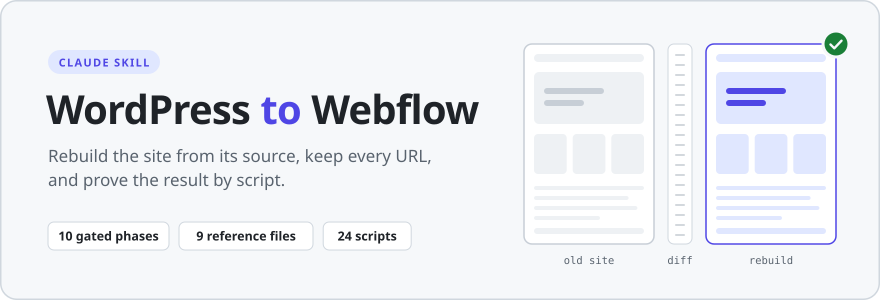
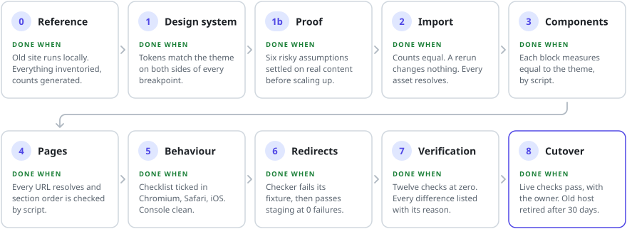

<p align="center">
  <picture>
    <source media="(prefers-color-scheme: dark)" srcset="docs/banner-dark.svg">
    
  </picture>
</p>

<p align="center">
  <a href="LICENSE"></a>
  
  
  
</p>

A [Claude skill](https://docs.claude.com/en/docs/claude-code/skills) for rebuilding a WordPress site in Webflow so that it looks and behaves the same, keeps every URL that matters, and stays editable by the site's own team.

It was written from one full migration (about 500 CMS items, 30 pages and 24 theme blocks), three follow-up structured-data jobs, and a second site on the same theme (about 370 items, 37 pages) built in one overnight run. It holds the method, a gate for every phase, the Webflow limits met along the way with their workarounds, and the scripts that did the checking.

**Contents:** [Why](#why-it-exists) · [What you can ask](#what-you-can-ask) · [The method](#the-method) · [Phases](#ten-phases-each-with-a-gate) · [What is inside](#what-is-inside) · [Scripts](#the-scripts) · [Traps](#the-traps-that-cost-the-most-time) · [Install](#install) · [Limits](#honest-limits)

## Why it exists

The obvious way to move a site is to open the old one, open Webflow, and rebuild each page by eye. That gets the colours right and nearly everything else subtly wrong: breakpoints, spacing tiers, which element carries which rule, how a slider behaves at its last slide, and the long tail of URLs nobody remembers.

This skill replaces looking with measuring. The WordPress theme and database are treated as the specification, the old site runs locally as the reference, and nothing counts as done until a script has shown it.

## What you can ask

Ask in plain words. The skill loads only the part it needs.

| You say | Claude does | Reads |
|---|---|---|
| "Move this WordPress site to Webflow." | Plans the ten phases, asks for the handful of things only the owner can provide, settles the routine questions by default, and starts with the local reference | [`SKILL.md`](skills/wordpress-to-webflow/SKILL.md), [`phases.md`](skills/wordpress-to-webflow/references/phases.md) |
| "Turn these redirect rules into Webflow redirects." | Captures what the live site really does, builds the import file with Webflow's escaping, and proves it with a checker | [`redirects.md`](skills/wordpress-to-webflow/references/redirects.md) |
| "Is the rebuild the same as the old site?" | Runs the structure, visual, behaviour, link, content, SEO and code-parity checks | [`verification.md`](skills/wordpress-to-webflow/references/verification.md) |
| "Add schema markup to our Webflow site." | Builds JSON-LD from the site's own words and public records, places it where it is safest, and checks every page | [`structured-data.md`](skills/wordpress-to-webflow/references/structured-data.md) |
| "Can editors add a new case study without breaking anything?" | Creates one the way an editor would, finds where it goes missing, and fixes the causes | [`verification.md`](skills/wordpress-to-webflow/references/verification.md) |
| "Webflow dropped my change." | Looks the symptom up among the limits already met | [`webflow-traps.md`](skills/wordpress-to-webflow/references/webflow-traps.md) |
| "We are ready to switch DNS." | Walks the cutover runbook with you: re-sync, launch checks, rollback, retirement | [`cutover.md`](skills/wordpress-to-webflow/references/cutover.md) |

The schema markup part works on any Webflow site, migrated or not.

## The method

1. **Build from source, not by eye.** The theme and database are the specification. The backup runs locally and that copy is the reference for every comparison.
2. **Inventory before building.** Every page, post, field, option, asset, URL and SEO value goes into machine-readable files. Acceptance counts are generated from them, never typed.
3. **Prove the risky parts small.** Component boundaries, body conversion, curated lists, filtering past 100 items and search are settled on a handful of real examples before anything is built at scale.
4. **Import so it can be rerun.** Identity is the WordPress id, not the slug, so the same import runs again at cutover without creating duplicates.
5. **Verify by script, with evidence.** Differences are found by comparing code and measured values, never pictures. A claim without output (counts, command results, measured values, file paths) does not count as done.

## Ten phases, each with a gate

<p align="center">
  <picture>
    <source media="(prefers-color-scheme: dark)" srcset="docs/phases-dark.svg">
    
  </picture>
</p>

<details>
<summary>The same as a table</summary>

| Phase | What happens | Done when |
|---|---|---|
| 0 Reference | The backup runs locally; pages, posts, options, assets, URLs and SEO values are inventoried | Counts are generated, reference measurements exist, the tools are proven on a throwaway |
| 1 Design system | Colours, type, spacing and buttons from the theme's own tokens | The numbers match on both sides of every breakpoint |
| 1b Proof | Six small proofs on real content | Each has a decision, a staging URL and the output that shows it |
| 2 Import | Collections, two-pass import, media, SEO fields | Counts are equal, a rerun changes nothing, every asset resolves |
| 3 Components | Blocks become components or page-owned shells, compiled from the rendered theme where possible | Each measures equal to the reference |
| 4 Pages | Pages and templates composed from a generated map | Every URL resolves; section and heading order are checked by script |
| 5 Behaviour | One script and one stylesheet for what Webflow cannot do | The behaviour checklist is ticked in Chromium, Safari and iOS, console clean |
| 6 Redirects | URL manifest, redirects, head tags, sitemap, structured data | The checker fails its fixture, then passes staging with zero failures |
| 7 Verification | Twelve checks, editor acceptance, the new-item test | Every check is at zero and every remaining difference is listed with its reason |
| 8 Cutover | Re-sync, DNS, launch checks, always with the owner | Live checks pass and the old host is retired after 30 days |

</details>

## What is inside

```
skills/wordpress-to-webflow/
├── SKILL.md                       the method, what to ask the owner for, where to look
├── references/                    nine files, loaded only when needed
├── scripts/                       24 scripts, config-driven
└── assets/                        an example config file
```

| Reference | What it answers |
|---|---|
| [`phases.md`](skills/wordpress-to-webflow/references/phases.md) | What does each phase involve, and what must be true before the next one starts? |
| [`wordpress-side.md`](skills/wordpress-to-webflow/references/wordpress-side.md) | How do I run the backup locally, what do I inventory, and what does WordPress do that its exports don't show? |
| [`import.md`](skills/wordpress-to-webflow/references/import.md) | Which Webflow field does each custom field become, and how do I import items, media and long-form bodies safely? |
| [`webflow-traps.md`](skills/wordpress-to-webflow/references/webflow-traps.md) | Why did the API refuse, drop or lose my change, and what works instead? About 135 findings on styles, breakpoints, Collection Lists, components, slots, bindings, head code, search, the sitemap, and what a site with no site plan will and will not do |
| [`redirects.md`](skills/wordpress-to-webflow/references/redirects.md) | Which old URLs matter, how does Webflow's redirect syntax really behave, and how do I prove nothing is lost? |
| [`verification.md`](skills/wordpress-to-webflow/references/verification.md) | How do I show the rebuild matches, and which differences are only noise? |
| [`structured-data.md`](skills/wordpress-to-webflow/references/structured-data.md) | What JSON-LD belongs on each page, where does it go in Webflow, how do I publish without shipping someone else's work, and how does Wikidata fit in? |
| [`cutover.md`](skills/wordpress-to-webflow/references/cutover.md) | What happens before, on and after the day DNS moves? |
| [`example-theme-mapping.md`](skills/wordpress-to-webflow/references/example-theme-mapping.md) | What does a finished block-by-block mapping look like? |

## The scripts

All of them read one `site.config.json` (start from [`site.config.example.json`](skills/wordpress-to-webflow/assets/site.config.example.json)) and take the Webflow token only from the `WEBFLOW_TOKEN` environment variable. Full details are in [`scripts/README.md`](skills/wordpress-to-webflow/scripts/README.md).

| Question | Script |
|---|---|
| Is the unpacked backup complete, with no file lost to a capital letter? | `archive-check.py` |
| Is this block the same as the theme's, value by value? | `measure-blocks.mjs` |
| Does every page have the sections the old one has, in order? | `heading-sequence.mjs` |
| What does the old site really do with each URL? | `live-capture.mjs` |
| What paths does the new site serve? | `staging-paths.mjs` |
| What goes in Webflow's redirect import? | `build-redirects.py` |
| Does every old URL land in the right place, in one hop? | `check-urls.mjs` |
| Any broken links, or leftovers pointing at the old host? | `crawl-links.mjs` |
| One `h1`, the right title and description, valid JSON-LD? | `seo-check.mjs` |
| Any console errors, at any width? | `console-check.mjs` |
| What scripts, tags and metas did the old site print that the new one does not? | `code-parity.py`, `code-parity-report.py` |
| Does every body read the same? Did two words fuse? | `compare-bodies.mjs`, `glued-words.mjs` |
| Do the CMS counts still match? | `cms-counts.mjs` |
| Is the sitemap free of pages that should not be in it? | `sitemap-exclude.mjs` |
| Is the schema markup valid and true to the page? | `verify-jsonld.mjs`, `schema-vocab-check.mjs` |
| What exactly would a live publish ship? | `diff-staging-live.py` |
| Does an unreleased script build work on real pages? | `bundle-swap.mjs` |

Browser checks block common trackers and form submissions by default, so a test run cannot create a real lead.

## The traps that cost the most time

<details>
<summary>Show them</summary>

1. Webflow's breakpoints are rarely all the theme's. Read the theme's real screens and measure both sides of every one.
2. Collection List settings, "current item" links and multi-image sources are partly Designer-only. Plan a short Designer pass at the end of each structure.
3. Removing a Collection List's Empty State deletes the whole list, silently. Hide it instead.
4. A Collection List built inside a component definition by API does not survive.
5. A timed-out bulk create may still have created the items. Re-list and match on your own id before sending again.
6. Redirect and robots.txt APIs need an Enterprise plan. The dashboard import works on other plans, and replaces every existing redirect.
7. `noindex` does not remove a page from Webflow's sitemap. That is a separate setting, and saving page settings in the Designer resets it.
8. CMS templates print no Open Graph or Twitter tags unless you add them.
9. Items an editor creates lack importer-only fields. Anything keyed on those fields silently drops new items.
10. The old site holds redirects and behaviour its exports don't show. Capture what the live site actually does.
11. The API reports success for writes it did not store: classes with no style behind them, some bindings, `unset` values, shorthand grid properties. Read back, then measure.
12. A site with no site plan builds and publishes to staging, but refuses 301 redirects and sitemap controls and shows only sample search results. Those checks move to cutover.
13. A template measured in part hides what is missing from the rest. Measure whole templates, and crawl every page's heading order early.

The full list, with the workaround for each, is in [`webflow-traps.md`](skills/wordpress-to-webflow/references/webflow-traps.md).

</details>

## Install

**Claude Code, as a plugin (easiest).** In a Claude Code session:

```
/plugin marketplace add seanbtw/wordpress-to-webflow
```

```
/plugin install wordpress-to-webflow@seanbtw-skills
```

Or from a terminal: `claude plugin marketplace add seanbtw/wordpress-to-webflow`, then `claude plugin install wordpress-to-webflow@seanbtw-skills`.

**Claude Code, as a plain skill.** Clone the repository and link the skill folder into your personal skills (or copy it into a project's `.claude/skills/`):

```bash
git clone https://github.com/seanbtw/wordpress-to-webflow.git
```

```bash
ln -s "$(pwd)/wordpress-to-webflow/skills/wordpress-to-webflow" ~/.claude/skills/wordpress-to-webflow
```

**The Claude apps.** Download `wordpress-to-webflow.zip` from the [latest release](https://github.com/seanbtw/wordpress-to-webflow/releases/latest), then in Claude open Customize, Skills, add a skill, and upload the zip. The method and the reference files work there; the scripts are written for a machine where Claude can run Node, Python and a browser.

Then start a new session and ask for the job. To set the scripts up after cloning:

```bash
cd wordpress-to-webflow/skills/wordpress-to-webflow/scripts && npm install && npx playwright install chromium
```

**You will need**

- The Webflow MCP server connected, with its Designer companion app, and a Webflow site API token
- Docker, for the local copy of the old site
- Node 20.18 or later, Python 3.9 or later, and `curl`
- A full backup of the WordPress site (files and database) and the host's redirect rules export

## Honest limits

- **It has been through two migrations, both of sites on the same theme.** The second build ran its own copies of the first build's scripts. The generalised scripts here have been exercised against test fixtures, not yet end to end against a real site.
- **Webflow moves.** The limits were observed in November 2026 on a Premium site plan and on a site with no plan; a few changed within a day, and a few differed between the two builds. Re-test one with a throwaway write before leaning on it.
- **It does not ship an importer, an inventory generator, a block compiler or a behaviour test suite.** Those depend on each site's theme and content model. The skill says what each must do.
- **It never writes copy.** Every word on the rebuilt site, and every string in the structured data, comes from the old site or a public record.
- **Cutover is done with the site's owner present.** The skill will not move DNS or publish to a live domain on its own.

There is no client content here, no site ids, no keys and no theme source code.

## Licence

[MIT](LICENSE).
